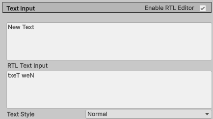

## Text Input

The text section is where you enter the text to display, and optionally customize it using [rich text markup](RichText.md).

|Property:| |Function:|
|---------|-|---------|
|**Text**||The input field for text to display.|
|**Text Style**||Select the text style configured in the [style sheet](StyleSheets.md).|